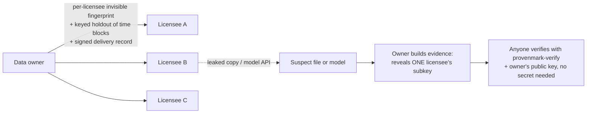

# ProvenMark · provenmark-verify

### Prove where your industrial data went — with evidence the other side can check for themselves.

[](LICENSE)

[](https://github.com/GANGMU-SBOM/provenmark-demo)

[中文说明](README.zh-CN.md)

You license sensor data, plant historian exports or test-bench recordings to several customers. Months later a copy
turns up online — smoothed, cropped, timestamps shifted. Or a competitor's forecasting model behaves suspiciously like
it has seen your data. **Who leaked it? Was it used to train AI?** And when you say so, why should anyone believe you?

ProvenMark answers with **statistical evidence that a third party can recompute without any secret key**. This
repository is the verifier: read the code, run it on the evidence, and decide for yourself.

> ⭐ **Star the repo** to follow the project, and **Watch → Custom → Releases** to get the white paper, new sample
> evidence and verifier releases as they come out.

---

## 60-second demo: catch the leaker of a disguised copy

```bash
git clone https://github.com/GANGMU-SBOM/provenmark-demo && cd provenmark-demo
pip install -e .
# download sample_evidence.zip from the Releases page and unzip it into demos/
bash demos/verify_sample_evidence.sh leak
```

The scenario: one plant export was delivered to three licensees, each copy carrying a different invisible fingerprint.
The copy "found online" was **smoothed with a 9-point moving average, cropped to the middle 60 % and re-stamped by
+7 s**. The owner's evidence says it came from licensee *beta*, with a family-wise p below 1e-90 (exact value in the bundle's report). You check it
(abridged output):

```
  OK   release_signature            the delivery record was signed by the owner at delivery time
  OK   signer_pinned                ... with the owner key you obtained yourself
  OK   commitment:ssw / csw / evt   the revealed keys are the ones committed at delivery, not chosen afterwards
  OK   suspect_file_hash            it is exactly the file in question
  OK   recomputed_z / recomputed_p  every statistic recomputed from scratch on your machine
  OK   recomputed_conclusion        the conclusion follows from the recomputed numbers, not from the report
evidence VERIFIED; claim supported
```

Change a single number in the evidence, swap the file or use the wrong owner key: verification fails.

**Second demo — training-use evidence through an API only.** A licensee trained a forecaster on its delivery and
serves it. The owner never sees the model weights, only API answers. The arbiter re-trains the reference model from the
signed recipe and recomputes the test: `bash demos/verify_sample_evidence.sh training` (needs `pip install -e ".[torch]"`).

## How it works



* **Fingerprints inside the values, not metadata.** Each licensee's copy carries a keyed ±1 pattern at about 1/10 of
  the sensor noise, within each sensor's tolerance; physical constraints (ranges, rates, conservation laws) and fault
  labels are kept. Detection is blind: key + public record, no original needed.
* **Training-use evidence without touching the data.** Each delivery silently withholds a keyed 20 % of time blocks.
  A model trained on the delivery predicts delivered blocks better than withheld ones; an exact permutation test
  against 10,000 decoy keys says whether that is chance.
* **Keys fixed in advance.** Every key is committed (SHA-256) inside an Ed25519-signed delivery record. In a dispute
  only the accused licensee's subkey is revealed; the master key never is.
* **Security from the key, not from secrecy.** All algorithms are public (Kerckhoffs). Predicting the marks without
  the key reduces to breaking AES-256 ([docs/FORMAL.md](docs/FORMAL.md), S1).

## What we have measured

Two public industrial datasets (ETTm1 transformer monitoring, SKAB water-pump test bench), CPU-scale models,
3–6 seeds per cell. Full details in the white paper (coming to Releases).

| | Result |
|---|---|
| Leak tracing (SKAB, 10 customers) | correct leaker under noise, rounding, unit change, resampling, crop + subsample, timestamp shifts, 2–3-copy collusion and an AI denoiser, with **zero false attributions** |
| Data fidelity | 680/680 fidelity certificates passed; anomaly-detection F1 0.7485 → 0.7483 |
| Training-use evidence | strongly-fitting models detected and attributed with the delivery at **16 %** of their training data (6/6, SKAB); survives output noise, quantisation, ensembling, fine-tuning and distillation |
| False positives | copy detection: provably ≤ exp(−z²/2) for any data ([FORMAL.md](docs/FORMAL.md) T1); training evidence: exact permutation p-values, 100 independent null models within nominal rates |

**Where it applies** — stated up front, because the other side's expert will look for it anyway:

* Like any forensic evidence, this is statistical evidence with a stated error rate, not a mathematical proof; a
  model or copy that is not detected is not thereby cleared.
* Training-use evidence is strongest for models that really learned your data — the ones worth worrying about.
  Linear models memorise little and are not detected; weakly-fitting models can evade it on purpose; fine-tuned
  foundation models are not yet tested.
* Leak tracing holds up to 2–3 colluding customers; five or more averaging their copies plus noise can push the
  fingerprint below the evidence threshold.
* The number of customers screened is declared by the owner, and the verifier says so. We also correct ourselves in
  public: one auxiliary mark (`tone`) gave invalid p-values on data with spectral lines and is now excluded from every
  decision ([FORMAL.md](docs/FORMAL.md) N1).

More in the [FAQ](docs/FAQ.md): *Who leaked it? Can we prove AI training? How is the evidence used in a dispute?
Can it accuse an innocent customer? Can AI break it?*

## Use the verifier

```bash
pip install -e .            # add [torch] for training evidence with a neural reference model
provenmark-verify verify-evidence evidence.json suspect.csv --pubkey owner.pub.json
provenmark-verify verify-evidence evidence_training.json --original original.csv \
    --predictions predictions.npy --pubkey owner.pub.json
provenmark-verify holdout-queries original.csv --evidence evidence_training.json --out queries.npz   # re-query the model yourself
provenmark-verify verify-manifest data.csv --manifest data.csv.release.json --pubkey owner.pub.json --time-col ts
```

`--pubkey` is required: without the owner's public key (obtained through an independent channel, not from the bundle)
the signer is not pinned and the result is never VERIFIED. Exit code 0 = verified. Every field and every check:
[docs/FORMATS.md](docs/FORMATS.md).

**Try the basic watermark on your own data** (evaluation only):

```bash
provenmark-verify keygen --out me.pmkey --public-out me.pub.json        # keep me.pmkey secret
provenmark-verify ssw-mark plant.csv --key me.pmkey --recipient acme --time-col ts --tol temp_c=0.05
provenmark-verify ssw-detect copy.csv --key me.pmkey --release plant.acme.csv.release.json
```

## What's in this repository

| | |
|---|---|
| `src/provenmark_verify/` | the verifier, every detector that can appear in a delivery record, the statistical tests |
| `docs/FORMAL.md`, `formal/` | what is proven, under which assumptions, with machine-checked (z3) lemmas — and what can only be measured |
| `docs/FORMATS.md` | evidence / record formats and the verification procedure, precise enough to write your own verifier |
| `docs/FAQ.md` | the questions people ask first |
| `demos/` | sample evidence on synthetic plant data (bundles in Releases) |

The embedding engine, constraint-aware marking, keyed delivery and the evidence-collection tooling belong to the
commercial ProvenMark product and are **not** needed to verify anything here.

## Who it is for

* **Industrial data providers** who license data and want enforceable usage terms: the commercial product.
* **Licensees, experts, arbitrators, courts** who are handed ProvenMark evidence: this repository, free of charge.
* **Researchers** in dataset watermarking and training-data attribution: the white paper, the proofs and the formats.

## Contact

Commercial use, pilots on your own data, research collaboration: **64031875@qq.com**
Security issues: [SECURITY.md](SECURITY.md).

If this is useful to you, a ⭐ helps others find it.

## Licence

Code: **source-available** under the [PolyForm Shield License 1.0.0](LICENSE) (see [NOTICE](NOTICE)). Anyone may use,
read, modify and redistribute it for any purpose, including companies, experts and law firms verifying evidence,
except to provide a product that competes with it. It is not an OSI open-source licence.
Documentation (README, docs/) and the synthetic sample data and models (demos/): [CC BY 4.0](https://creativecommons.org/licenses/by/4.0/).
The SMT proof script `formal/smt_proofs.py` is code and falls under the PolyForm Shield licence.
