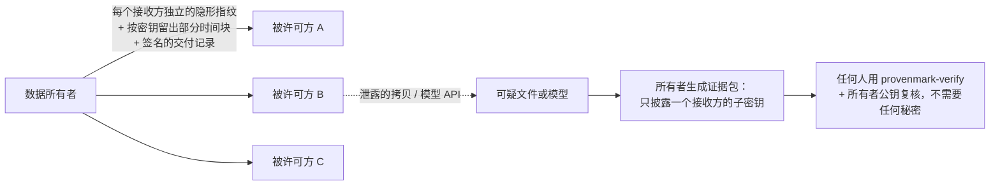

# ProvenMark · provenmark-verify

### 数据交付出去之后，证明它去了哪里——而且证据对方也能自己核对。

[](https://pypi.org/project/provenmark-verify/)
[](LICENSE)

[](https://github.com/GANGMU-SBOM/provenmark-demo)

[English](README.md)

你把设备传感器数据、产线历史库导出、试验台记录授权给了好几家客户。几个月后，网上出现一份拷贝——被平滑过、截过片段、时间戳也挪过；
或者某家公司的预测模型，表现得像是"见过"你的数据。**是谁泄露的？是不是被拿去训练了 AI？** 更难的是：你这么说，别人凭什么信？

ProvenMark 给出的是**第三方不需要任何密钥就能自己重算的统计证据**。这个仓库就是复核工具：代码摆在这里，拿证据跑一遍，结论自己判断。

> ⭐ **点个 Star** 关注项目进展；**Watch → Custom → Releases** 可以第一时间收到白皮书、新的示例证据和复核工具的发布。

---

## 60 秒演示：揪出一份"伪装过"的泄露拷贝

```bash
pip install provenmark-verify
curl -LO https://github.com/GANGMU-SBOM/provenmark-demo/releases/latest/download/sample_evidence.zip && unzip -q sample_evidence.zip
provenmark-verify verify-evidence sample_evidence/leak/evidence.json sample_evidence/leak/found_online.csv \
    --pubkey sample_evidence/leak/owner.pub.json
```

模拟场景（合成数据，各方均为虚构）：同一份工厂数据交付给 3 个被许可方，每份拷贝带着各不相同的隐形指纹。网上发现的拷贝被**做了 9 点移动平均、只留中间 60%、
时间戳整体 +7 秒**。所有者的证据指向被许可方 *beta*，族错误率 p 低于 1e-90（确切值见证据包里的报告）。你来核对（输出节选）：

```
  OK   release_signature            交付记录在交付时就由所有者签名
  OK   signer_pinned                ……而且是你自己拿到的所有者公钥
  OK   commitment:ssw / csw / evt   披露的密钥就是交付时承诺的那把，不是事后挑的
  OK   suspect_file_hash            文件就是争议中的那一份
  OK   recomputed_z / recomputed_p  每个统计量都在你自己的机器上从头重算
  OK   recomputed_conclusion        结论来自重算的数字，而不是报告里写的数字
evidence VERIFIED; claim supported
```

把证据里任何一个数字改一下、换一个文件、或者用错所有者公钥——复核都会失败。

**第二个演示：只通过模型 API 证明"拿去训练了"。** 某被许可方违约用交付数据训练了预测模型并对外提供服务；所有者看不到模型权重，
只能调用 API。复核方按签名登记的配方自己训练参考模型、重算检验：

```bash
pip install "provenmark-verify[torch]"
provenmark-verify verify-evidence sample_evidence/training/evidence_training.json \
    --original sample_evidence/training/plant.csv --predictions sample_evidence/training/predictions.npy \
    --pubkey sample_evidence/training/owner.pub.json
```

两个场景的详细说明，以及"试着攻破它"：见 [demos/](demos/README.md)。

## 原理



* **指纹在数值里，不在元数据里。** 每个接收方的拷贝带一个密钥决定的 ±1 图样，幅度约为传感器噪声的 1/10，并受每个传感器的精度容差限制；
  量程、变化率、守恒关系等物理约束和故障标签保持不变。检测是盲检测：只需密钥和公开记录，不需要原始数据。
* **训练使用证据，数据一个值都不改。** 每次交付按密钥悄悄少给 20% 的时间块。在交付数据上训练过的模型，对交付块的预测明显好于留出块；
  用 1 万把诱饵密钥做精确置换检验，判断这是不是巧合。
* **密钥事先固定。** 每把密钥都以承诺值（SHA-256）写进 Ed25519 签名的交付记录。发生争议时只披露被指认接收方的子密钥，主密钥永不披露。
* **安全来自密钥，而不是算法保密。** 算法全部公开（Kerckhoffs 原则）；不知道密钥而预测出标记，等价于攻破 AES-256（[docs/FORMAL.md](docs/FORMAL.md) S1）。

## 实测结果

两个公开工业数据集（ETTm1 变压器监测、SKAB 水泵试验台），三类预测模型（线性、MLP、Transformer 类），每种设置 3–6 次独立重复。详细实验报告可来信索取。

| | 结果 |
|---|---|
| 泄露追溯（SKAB，10 个客户） | 加噪、取整、单位换算、重采样、截取 + 抽样、时间戳平移、2–3 份拷贝合谋、AI 去噪器之下都找到正确泄露方，**零错误指认** |
| 数据保真 | 680/680 份保真证书通过；异常检测 F1 0.7485 → 0.7483 |
| 训练使用证据 | 对拟合较强的模型，交付数据只占其训练集 **16%** 时 6/6 检出并指认（SKAB）；扛住 API 输出加噪、量化、集成、微调、蒸馏 |
| 误报 | 拷贝检测：对任何数据误报率可证明 ≤ exp(−z²/2)（[FORMAL.md](docs/FORMAL.md) T1）；训练证据：精确置换 p 值，100 个独立零模型误报在名义水平内 |

**适用范围**——我们主动写清楚，因为对方的专家反正会去找：

* 和所有取证手段一样，这是误报率明确的统计证据，不是数学证明；没检出的拷贝或模型并不因此就被"洗清"。
* 训练使用证据对"真正学到你数据的模型"最有力，而这正是需要担心的那类模型；线性模型几乎不记住具体数据，检不出；
  拟合较弱的模型若有意规避，证据可能消失。
* 泄露追溯扛得住 2–3 个客户合谋；5 个以上客户把拷贝平均再加噪，可能把指纹压到证据阈值以下。
* 一共筛查了多少个客户由所有者声明，复核结果会明确标出。我们也公开纠正自己的问题：一种辅助标记（`tone`）在数据带谱线时 p 值不成立，
  现已排除在所有判定之外（[FORMAL.md](docs/FORMAL.md) N1）。

更多见 [FAQ](docs/FAQ.zh-CN.md)：*泄露了能查出是谁吗？能证明拿去训练了 AI 吗？证据在纠纷里怎么用？会不会冤枉无辜客户？会不会被 AI 破解？*

## 使用复核工具

```bash
pip install provenmark-verify          # 复核登记了神经网络参考模型的训练证据时，加 [torch]
provenmark-verify verify-evidence evidence.json suspect.csv --pubkey owner.pub.json                 # 拷贝 / 泄露证据
provenmark-verify verify-evidence evidence_training.json --original original.csv \
    --predictions predictions.npy --pubkey owner.pub.json                                            # 训练使用证据
provenmark-verify holdout-queries original.csv --evidence evidence_training.json --out queries.npz   # 自己重新查询模型
provenmark-verify verify-manifest data.csv --manifest data.csv.release.json --pubkey owner.pub.json --time-col ts
```

从源码安装（阅读或修改代码）：`git clone https://github.com/GANGMU-SBOM/provenmark-demo && cd provenmark-demo && pip install -e ".[dev]" && pytest`。

必须用 `--pubkey` 提供所有者公钥（通过独立渠道获取，不要用证据包里附带的）：不提供时无法确认签名者，复核结果一律不通过。
退出码 0 = 复核通过。每个字段、每项检查的含义见 [docs/FORMATS.md](docs/FORMATS.md)。

**在自己的数据上试用基础水印**（仅供评测）：

```bash
provenmark-verify keygen --out me.pmkey --public-out me.pub.json        # me.pmkey 必须保密
provenmark-verify ssw-mark plant.csv --key me.pmkey --recipient acme --time-col ts --tol temp_c=0.05
provenmark-verify ssw-detect copy.csv --key me.pmkey --release plant.acme.csv.release.json
```

## 仓库里有什么

| | |
|---|---|
| `src/provenmark_verify/` | 复核工具、交付记录中可能出现的所有检测器、统计检验 |
| `docs/FORMAL.md`、`formal/` | 哪些性质已证明、依赖什么假设、z3 机器检验的引理——以及哪些只能靠实验 |
| `docs/FORMATS.md` | 证据包与记录格式、复核步骤，详细到可以据此自己写一个复核器 |
| `docs/FAQ.zh-CN.md` | 大家最先问的问题 |
| `demos/` | 合成工厂数据上的示例证据（证据包在 Releases） |

嵌入引擎、约束感知加标、按密钥留出交付、取证工具属于 ProvenMark 商业版，复核这里的任何证据都**不需要**它们。

## 适合谁

* **工业数据提供方**：授权分发数据、希望使用条款能落地执行——商业版。
* **被许可方、鉴定人、仲裁方、法院**：手里拿到了 ProvenMark 证据——本仓库，免费。
* **研究者**：数据集水印、训练数据归因方向——白皮书、证明与格式规范。

## 联系

商业合作、在你自己的数据上做试点、研究合作：**64031875@qq.com**
安全问题：见 [SECURITY.md](SECURITY.md)。

觉得有用的话，点个 ⭐ 能让更多人看到。

## 许可

代码以 [PolyForm Shield License 1.0.0](LICENSE) **公开源码**（见 [NOTICE](NOTICE)）：任何人都可以为任何目的使用、阅读、修改、再分发——
包括公司、鉴定机构、律所用它复核证据——唯独不能用它提供与之竞争的产品。它不是 OSI 定义的开源许可。
文档（README、docs/）与合成示例数据和示例模型（demos/）：[CC BY 4.0](https://creativecommons.org/licenses/by/4.0/)；
SMT 证明脚本 `formal/smt_proofs.py` 属于代码，按 PolyForm Shield 许可。
